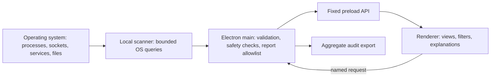

<div align="center">
  
  <h1>AEGIS SENTINEL</h1>
  <p><strong>Local-first system visibility. Human-led security decisions.</strong></p>
  <p>A cross-platform desktop toolkit for inspecting system posture, tracing useful signals, and keeping uncertainty visible.</p>
  <p>
    <a href="#quick-start">Quick start</a> ·
    <a href="demo.html">Demo source</a> ·
    <a href="docs/ARCHITECTURE.md">Architecture</a> ·
    <a href="SECURITY.md">Report a vulnerability</a>
  </p>
  <p>
    <a href="https://github.com/saif-infinity/AEGIS-Sentinel/actions/workflows/ci.yml"></a>
    
    
    
  </p>
</div>

> [!IMPORTANT]
> **AEGIS Sentinel is an inventory and heuristic posture aid—not antivirus, a malware scanner, or a security guarantee.** Signals need human review. An empty result or a high score does not prove a device is safe.

## Contents

- [What it does](#what-it-does)
- [See it in action](#see-it-in-action)
- [Quick start](#quick-start)
- [Run checks and build](#run-checks-and-build)
- [How the engine works](#how-the-engine-works)
- [Safety and privacy](#safety-and-privacy)
- [Project map](#project-map)
- [Roadmap and contribution](#roadmap-and-contribution)
- [License](#license)

## What it does

AEGIS Sentinel brings several read-only inventory sources together in one desktop interface. Its posture score and risk labels are transparent heuristics designed to help you decide **what to inspect next**—they do not identify malware.

| Workspace | What you can inspect |
|---|---|
| **Dashboard** | System and disk telemetry, process-risk indicators, startup/service risk summary, scan findings, and an explainable heuristic posture score |
| **File Scanner** | Bounded scans for old temporary/cache candidates, large files, and duplicate content (SHA-256). Only reviewed old-junk candidates can be moved to the system Trash. |
| **Processes** | Process inventory, short CPU sampling, memory use, and clear name/path/resource heuristics; optional process stop requires native confirmation. |
| **Applications** | Installed-software inventory and heuristic flags; uninstall is enabled only when a supported, validated OS method is available. |
| **Network** | TCP/UDP endpoints, listeners, and owning-process data where permitted; highlights risk-correlated listeners and attribution gaps. Includes firewall status. |
| **Startup & Services** | Read-only Windows services, startup commands and logon/boot tasks; macOS launchd; Linux systemd and XDG autostart. Correlates processes and listeners where possible. |
| **Security Audit** | Nine local posture checks, including process/listener and startup/service correlation, plus a privacy-limited JSON summary. |
| **Updates** | Status from the operating-system update service and a native installation action where available. |

## See it in action

The generated [`demo.html`](demo.html) is a browser-only preview with **mock data**. It does not inspect or change your computer, stop processes, remove files, or install updates.

```bash
npm run demo
```

Open `demo.html` in a browser after the build. The demo is regenerated from `demo.template.html`, `src/styles.css`, and `src/renderer.js`.

## Quick start

**Requirements:** Node.js `>=22.12.0` and npm.

```bash
git clone https://github.com/saif-infinity/AEGIS-Sentinel.git
cd AEGIS-Sentinel
npm ci
npm start
```

The desktop app uses native operating-system tools. Availability and detail vary with OS version, installed utilities, permissions, and the current session; unavailable data is shown as **unknown**, not silently treated as clean.

## Run checks and build

```bash
npm run check      # JavaScript syntax checks
npm test           # scanner + headless renderer regression tests
npm run scan       # live local scan in the terminal
npm run demo       # regenerate the self-contained browser preview
```

Platform packages are built on their target OS:

```bash
npm run dist:win     # NSIS installer + portable package
npm run dist:mac     # DMG + ZIP
npm run dist:linux   # AppImage + DEB + RPM
```

Build outputs go to `release/`. Code signing, macOS notarization, and an update-distribution service are not configured yet. Validate installers and system permission dialogs on clean machines before distributing a release.

## How the engine works



- **Cross-sensor correlation:** exposed listeners are joined to process-risk heuristics by PID. Startup entries with a matching executable path are labeled **candidates**; that match does not prove the process was launched by that entry.
- **Coverage stays visible:** supported sources are tracked individually. Permission failures, missing tools, truncated results, and unavailable process/network snapshots remain partial or unknown rather than becoming a reassuring zero.
- **Bounded file scanning:** scans stream through constrained roots, depth, time, and result limits. Cleanup accepts only candidates from the current scan and revalidates them before moving them to Trash.
- **No generic renderer IPC:** Electron context isolation, renderer sandboxing, disabled Node integration, a restrictive CSP, and method-specific preload APIs keep OS access in the main process.

<details>
  <summary><strong>Supported startup/service sources</strong></summary>
  <br />

  | Platform | Sources inspected |
  |---|---|
  | Windows | Services, startup commands, and scheduled logon/boot tasks |
  | macOS | launchd jobs and property lists |
  | Linux | system and user systemd services, plus system and user XDG autostart entries |

  This is a bounded selection of OS-managed sources, **not an exhaustive persistence scan**. It does not cover every shell profile, scheduled job, application-specific mechanism, or custom launcher.
</details>

## Safety and privacy

### Deliberate, reviewable actions

- Startup and service inventory is **read-only**; it never disables, removes, or launches an entry.
- File cleanup is limited to selected, recently scanned old-junk candidates. Changed files and symbolic links are rejected; a native confirmation is required before moving files to Trash.
- Large-file and duplicate scans are informational and have no delete action.
- Process stop, supported application removal, firewall changes, and update installation require explicit native confirmation where available.

### What the audit report contains

The exported JSON contains allowlisted check statuses and aggregate counts. It omits raw logs, usernames, hostnames, executable paths, process/service/startup names, command lines, and remote addresses. Unavailable counts remain `null`, not zero. See [Architecture & trust boundaries](docs/ARCHITECTURE.md) for data flow and [SECURITY.md](SECURITY.md) for private vulnerability reporting.

The scanner does not upload scan results to an AEGIS service. The application shell may request interface fonts from Google Fonts; that ordinary web request can disclose network metadata to Google.

<details>
  <summary><strong>Important limitations</strong></summary>
  <br />

  Process labels, listener correlation, startup-command heuristics, and the 0–100 score are simple indicators—not probabilities, a vulnerability assessment, or an antivirus verdict. Listener ownership can be unavailable or change between OS queries. An executable-path match is only a candidate. OS commands may be missing, restricted, or return partial data. “No findings” does not mean a device is secure.
</details>

## Project map

```text
AEGIS-Sentinel/
├── main.js                  # Electron window, validated IPC, confirmations, report allowlist
├── preload.js               # fixed, named contextBridge methods
├── lib/scanner.js           # local cross-platform inventory and correlation engine
├── src/
│   ├── index.html            # desktop app shell
│   ├── styles.css            # interface design system
│   └── renderer.js           # dashboard and seven other V1 views
├── test/smoke.js             # scanner + jsdom UI regressions
├── demo.template.html        # inert browser-demo template
├── demo.html                 # generated browser preview
├── assets/
│   ├── icon.png              # application icon
│   └── readme-cover.png      # README hero artwork
├── docs/                     # architecture and security roadmap
└── SECURITY.md               # vulnerability reporting policy
```

## Roadmap and contribution

See the [security hardening roadmap](docs/SECURITY_ROADMAP.md) for known release-readiness work. CI runs syntax checks, regression tests, the standalone scanner, and demo freshness checks on Linux, Windows, and macOS; a separate job audits the locked npm dependency tree. These checks do not replace clean-machine GUI and package testing.

Before opening a change, run `npm run check` and `npm test`. For changes to the interface, also run `npm run demo` and include the regenerated `demo.html`.

## License

**Proprietary — © 2026 AEGIS Labs.** The V1 application has no in-app paid tier, license-key check, checkout, or feature gate.
